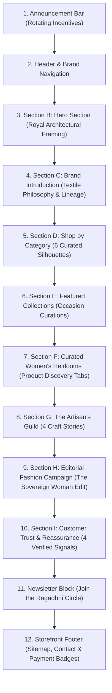

# Ragadhni — Indian Women's Ethnic & Traditional Casual Wear

> A direct-to-consumer (D2C) women's Indian ethnic fashion and traditional accessories e-commerce platform built with Next.js 15, React 19, TypeScript, Tailwind CSS, and Prisma.

---

## Table of Contents

- [1. Project Introduction](#1-project-introduction)
- [2. Project Status](#2-project-status)
  - [Currently Implemented](#currently-implemented)
  - [Planned / Future Roadmap](#planned--future-roadmap)
- [3. Design System](#3-design-system)
  - [Colour Palette](#colour-palette)
  - [Typography System](#typography-system)
  - [Visual Direction](#visual-direction)
- [4. Homepage Architecture](#4-homepage-architecture)
- [5. Hero Section](#5-hero-section)
- [6. Shopping Experience](#6-shopping-experience)
  - [Product Cards](#product-cards)
  - [Product Discovery & Curated Tabs](#product-discovery--curated-tabs)
  - [Supported Women's Categories](#supported-womens-categories)
- [7. Navigation System](#7-navigation-system)
  - [Desktop Navigation](#desktop-navigation)
  - [Mobile Navigation Drawer](#mobile-navigation-drawer)
- [8. Scroll Reveal Animation System](#8-scroll-reveal-animation-system)
  - [`useScrollReveal` Hook](#usescrollreveal-hook)
  - [`ScrollReveal` Component](#scrollreveal-component)
  - [Animation Motion Principles & Timing](#animation-motion-principles--timing)
- [9. Accessibility & Reduced Motion](#9-accessibility--reduced-motion)
- [10. Performance Architecture](#10-performance-architecture)
- [11. Technology Stack](#11-technology-stack)
- [12. Project Structure](#12-project-structure)
- [13. Data & Content Management](#13-data--content-management)
- [14. Responsive Design Strategy](#14-responsive-design-strategy)
- [15. Build & Verification Status](#15-build--verification-status)
- [16. Development Workflow](#16-development-workflow)
- [17. Code Quality & Engineering Conventions](#17-code-quality--engineering-conventions)
- [18. Project Roadmap](#18-project-roadmap)
- [19. Contributing & Development Notes](#19-contributing--development-notes)
- [20. License](#20-license)

---

## 1. Project Introduction

**Ragadhni** is a contemporary direct-to-consumer (D2C) Indian fashion and traditional accessories e-commerce storefront catering exclusively to women. The brand specializes in handcrafted ethnic wear, everyday traditional casuals, celebratory ensembles, and artisanal jewellery.

### Target Audience & Brand Positioning
Ragadhni is created for the modern woman who embraces her cultural roots through everyday comfort and festive elegance. By collaborating directly with master weaving cooperatives and artisan clusters across Chanderi (Madhya Pradesh), Bagru and Barmer (Rajasthan), Lucknow (Awadh), and Bengal, Ragadhni eliminates distributor markups to offer authentic, natural-fibre handlooms at transparent and honest prices.

### Visual Identity: Heritage Luxe × Indian Editorial
The storefront is designed under the **Heritage Luxe × Indian Editorial** aesthetic:
- **Rooted Indian Heritage:** Regal architectural jharokha arch framing, palace-inspired jaali lattice geometry, and artisanal craft provenance.
- **Contemporary Editorial Art Direction:** High-fashion typography hierarchy, magazine-grade vertical portrait framing (4:5 ratio), generous negative space, and refined asymmetrical layouts.
- **Atmospheric Palette:** Rich royal burgundy, deep dark maroon, and wine surfaces accented by restrained antique-gold hairlines, earthy terracotta, and warm ivory canvases.
- **Cinematic Rhythm:** Subtle, hardware-accelerated scroll reveals that guide the eye naturally without overwhelming the shopping experience.

> **Note:** Ragadhni is an exclusively women's ethnic clothing and accessories brand. Men's wear, unisex clothing, and general Western fashion are outside the brand scope.

---

## 2. Project Status

The storefront is currently an active frontend implementation with static mock data, full client-side catalog interactions, and a production-ready PostgreSQL Prisma schema.

### Currently Implemented

- **Responsive Storefront Framework:** Unified Next.js 15 App Router architecture with global layout, self-hosted fonts, and SEO metadata.
- **Women's-Only Navigation & Catalog Routes:** Dedicated routes for `/women`, 9 subcategories (`/women/[category]`), 5 curated occasion edits (`/collections/[slug]`), and individual garment detail pages (`/product/[slug]`).
- **Hero Section:** Architectural jharokha arch framing, deep burgundy ambiance, Cormorant Garamond editorial headline (*"Where Heritage Meets Her"*), dual master CTAs, and floating Textile No. 01 provenance plaque.
- **Shop by Category:** 6 curated women's apparel and accessories silhouette cards with smooth image zoom.
- **Featured Collections:** Occasion-led curations combining a wide spotlight card (*The Festive Edit*) with a 2×2 grid (*Everyday Elegance*, *Traditional Classics*, *Contemporary Ethnic*, *Wedding Guest Edit*).
- **Interactive Product Tabs (`FeaturedProductTabs.tsx`):** Client-side tabbed product showcase (*Bestsellers*, *New Arrivals*, *All Pieces*) rendering dynamic product grids.
- **Product Cards (`ProductCard.tsx`):** 4:5 vertical portrait framing, subtle status badges (`Bestseller`, `New Arrival`), circular wishlist toggle, micro color swatches with active shade title, formatted INR pricing, and slide-up quick-add size picker.
- **Craftsmanship Storytelling (The Artisan's Guild):** 4 generational handloom traditions (*Chanderi Silk*, *Bagru Woodblock*, *Lucknowi Chikankari*, *Bengal Tussar Silk*).
- **Editorial Fashion Campaign:** Full-width magazine spread for *"The Sovereign Woman Edit"* in rich wine and gold.
- **Customer Trust & Reassurance:** 4 verified customer reassurances (*Authentic Handloom Weaves*, *Free Delivery > ₹1,499*, *7-Day Doorstep Exchange*, *100% Secure Checkout & COD*).
- **Interactive Newsletter:** *"Join the Ragadhni Circle"* email capture form with instant confirmation feedback.
- **Desktop Navigation:** Sticky frosted header (`h-16 sm:h-[72px]`), letter-spaced wordmark, 2-column mega-menu dropdown, expandable search drawer with popular ethnic keyword suggestions, and live counter badges.
- **Mobile Navigation Drawer:** Slide-out thumb-friendly drawer with expandable category accordions, 44px+ touch targets, and customer care contact info.
- **Product Listing Engine (PLP):** Real-time multi-facet filtering (fabric, size, price) and 5-mode sorting across all collection and category routes.
- **Product Detail Experience (PDP):** Multi-angle thumbnail image gallery with hover zoom, size selector with low-stock warnings, interactive Indian size guide modal (Inches/Centimeters toggle), 6-digit Indian PIN code delivery estimator, and specifications accordions.
- **Scroll Reveal Animation System:** Custom zero-dependency viewport reveal system powered by native `IntersectionObserver` (`useScrollReveal` and `<ScrollReveal>`).
- **Accessibility & Reduced Motion:** Full `prefers-reduced-motion: reduce` compliance across all CSS animations and JavaScript observer hooks.

### Planned / Future Roadmap

The following capabilities are architected in the database schema and planned for future engineering phases, but are **not yet implemented**:

- **Production Database Connection:** Live PostgreSQL database queries via Prisma (currently using static mock catalog in `src/lib/mockData.ts`).
- **Customer Authentication:** NextAuth.js (Auth.js) supporting passwordless SMS/WhatsApp OTP and Google 1-click login.
- **Persistent Shopping Cart:** Server-synchronized cart and persistent browser storage (currently simulated via UI state).
- **Persistent Wishlist:** Authenticated customer wishlist persistence across devices.
- **Checkout Flow:** Multi-step Indian checkout with PIN-code-based state/city resolution and address book management.
- **Payment Gateway Integration:** Live Razorpay payment gateway (UPI, Netbanking, Cards) and verified Cash on Delivery (COD) confirmation flows.
- **Logistics & Courier APIs:** Automated Shiprocket/Delhivery Air Waybill (AWB) generation, dispatch tracking, and doorstep exchange pickups.
- **Staff Admin Dashboard:** Role-based administrative dashboard for catalog management, SKU inventory updates, and order fulfillment queues.
- **Production Full-Text Search:** Elasticsearch or PostgreSQL full-text search indexing.
- **Customer Reviews & Ratings:** Verified buyer reviews with photo uploads.
- **Analytics & Conversion Tracking:** Production event tracking for Indian e-commerce metrics.

---

## 3. Design System

Ragadhni's design system is configured in `tailwind.config.ts` and `src/styles/globals.css`. It balances traditional Indian royal aesthetics with modern luxury fashion editorial restraint.

### Colour Palette

The color system uses high-contrast royal dark tones balanced by warm luminous neutrals and restrained antique gold hairlines:

| Color Token | Hex Code | Role in Storefront |
| :--- | :--- | :--- |
| **Royal Burgundy** | `#35131F` | Primary brand color; used for hero masthead backgrounds, prominent buttons, badges, and footer accents. |
| **Wine** | `#501E2B` | Secondary dark tone; used for hover states, gradient depths, and campaign sections. |
| **Dark Maroon** | `#211419` | Deepest contrast tone; used for the architectural plinth, vignettes, and arch surrounds. |
| **Antique Ivory** | `#EDE0CD` | Warm supporting surface; used for secondary cards, panel fills, and subtle borders. |
| **Muted Gold** | `#C3A16B` | Precious accent tone; used for architectural hairlines, seasonal tags, star ratings, and subtle borders. |
| **Terracotta** | `#9A6B57` | Earthy Indian clay tone; used for eyebrow category tags, icons, and micro-accents. |
| **Warm White** | `#FAF5ED` | Primary background canvas (`--background`); soft, luminous surface reducing eye fatigue. |
| **Charcoal** | `#292326` | Primary high-readability text color (`--foreground`) for headings and body copy. |
| **Muted Grey** | `#77706B` | Secondary text color for fabric specifications, metadata, and subtitles. |

> **Gold Restraint Principle:** Gold (`#C3A16B`) is strictly utilized as a hairline accent, fine border, or micro-badge. It is never used as an overpowering background wash or gaudy metallic gradient, maintaining high-fashion editorial sophistication.

### Typography System

Ragadhni pairs a classical Indian literary serif with a clean geometric sans-serif:

- **Editorial Headings (`font-serif`):** `Cormorant Garamond` (Google Fonts). Applied to brand wordmarks, grand campaign headlines, section titles, and garment names. Evokes centuries of handloom pride and royal court lineages.
- **Interface & Body (`font-sans`):** `Manrope` (with `Plus Jakarta Sans` as fallback). Applied to navigation links, action buttons, prices, filter chips, specifications, and form controls. Ensures crisp legibility across high-density mobile screens.
- **Indian Pricing Notation:** Prices feature the Indian Rupee symbol (`₹`) formatted according to the Indian numbering system (e.g., `₹1,499`, `₹12,500`) via `formatPrice()` in `src/lib/utils.ts`.

### Visual Direction

- **Architectural Cusped Arches:** Sculptural jharokha arch geometry with single and double gold hairlines.
- **Negative Space & Breathability:** Generous vertical rhythm (`space-y-20 lg:space-y-32`) allowing photography and craftsmanship to stand out.
- **Authentic Handloom Focus:** Photography showcases true garment drapes, natural texture, and intricate weave patterns without generic stock clichés or artificial AI styling.

---

## 4. Homepage Architecture

The homepage (`src/app/page.tsx`) is structured into 12 coherent editorial sections:



1. **Announcement Bar (`AnnouncementBar.tsx`):** Slim promotional banner cycling key incentives (free shipping over ₹1,499, festive collections, verified COD) every 5 seconds with manual navigation chevrons.
2. **Header & Navigation (`Header.tsx`):** Sticky frosted header with letter-spaced wordmark, 2-column mega-menu dropdown, expandable search drawer with popular ethnic keyword tags, and live bag/wishlist counters.
3. **Hero Section:** Architectural royal arch framing, deep burgundy background, grand Cormorant Garamond headline (*"Where Heritage Meets Her"*), dual master CTAs, and Textile No. 01 provenance badge.
4. **Brand Introduction & Textile Lineage:** Brand philosophy explaining direct artisan partnerships, featuring an artisan craft diptych with overlapping loom badge and 2 feature pillars (*Pure Natural Fibres*, *Direct Weaver Transparency*).
5. **Shop by Category:** 6-column image-led silhouette grid with subtle staggered reveal (Sarees, Kurtas & Suits, Festive Lehengas, Ethnic Dresses, Artisanal Dupattas, Jewellery & Accessories).
6. **Featured Collections:** Occasion curations highlighting a wide spotlight card (*The Festive Edit*) and a 2×2 grid (*Everyday Elegance*, *Traditional Classics*, *Contemporary Ethnic*, *Wedding Guest Edit*).
7. **Curated Women's Heirlooms (`FeaturedProductTabs.tsx`):** Interactive product tabs (*Bestsellers*, *New Arrivals*, *All Pieces*) dynamically rendering 4-column product card grids with 80ms stagger.
8. **The Artisan's Guild:** Storytelling section exploring 4 handloom lineages (Chanderi Weaving, Bagru Woodblock, Lucknowi Chikankari, Bengal Tussar Silk) with 100ms stagger.
9. **Editorial Fashion Campaign:** Full-width magazine spread for *"The Sovereign Woman Edit"* in rich wine and gold with campaign photography.
10. **Customer Trust & Reassurance:** 4 verified customer benefits (Authentic Handloom Weaves, Free Delivery > ₹1,499 across 25,000+ pincodes, 7-Day Doorstep Exchange, 100% Secure Checkout & COD).
11. **Newsletter Block (`Footer.tsx`):** Email capture block (*"Join the Ragadhni Circle"*) with instant confirmation state.
12. **Storefront Footer (`Footer.tsx`):** 5-column sitemap, customer care contacts, copyright statement, and supported Indian payment badges (UPI, RuPay, Netbanking, Cards, COD).

---

## 5. Hero Section

The hero section (`src/app/page.tsx`, lines 150–325) anchors the brand's visual identity:

- **Architectural Plinth & Jharokha Arch:** A custom royal arch frame (`rounded-t-[240px] sm:rounded-t-[300px] lg:rounded-t-[340px]`) with subtle antique gold hairlines (`border-luxe-gold/35`) and an inner window container framing high-fashion editorial imagery of an Indian woman in a pure Chanderi saree.
- **Deep Burgundy Surroundings:** Layered background using royal burgundy (`#35131F`), dark maroon (`#211419`), and radial vignettes overlaid with a delicate palace jaali lattice texture (`.jaali-bg`).
- **Grand Editorial Headline:** Set in `Cormorant Garamond` at `text-4xl sm:text-6xl md:text-7xl lg:text-[76px] xl:text-[84px]`:
  > *"Where Heritage Meets Her."*
- **Supporting Narrative:** Reassures customers of pure Chanderi weaves, organic mulmul, and generational heirloom drapes designed for effortless everyday grace.
- **Dual Action CTAs:** Primary button in Muted Gold (*"Explore Collection"*) paired with a refined outline button (*"Discover Ragadhni"*).
- **Floating Provenance Card:** Positioned at the base of the arch window highlighting *"Textile No. 01 — Handwoven Chanderi Zari Drape (Madhya Pradesh)"* with pure mulberry silk warp and antique gold zari buttis.
- **Micro-Trust Indicators:** Four honest bullet points: *Handloom Weaves • Pure Natural Fibres • Direct Weaver Transparency • Free Delivery > ₹1,499*.
- **Hero Entrance Choreography:** Preserves its distinct CSS keyframe choreography (`.animate-hero-text` with 4 delay tiers and `.animate-arch-reveal` easing) rather than standard scroll reveals.

---

## 6. Shopping Experience

### Product Cards (`ProductCard.tsx`)

Every garment card is built to luxury fashion standards:

- **4:5 Vertical Portrait Ratio:** Prevents head/hem truncation, showing the complete drape of sarees, anarkalis, and kurtis.
- **Dual-State Hover Zoom:** Smooth image scaling (`group-hover:scale-105`) with gradual transition timing.
- **Subtle Status Badging:** Understated badges for `Bestseller` (burgundy) and `New Arrival` (gold).
- **Textile & Craft Chips:** Translucent white chip identifying the fabric (e.g. *Pure Chanderi Silk*, *Organic Mulmul*).
- **Circular Wishlist Control:** Top-right floating button with heart icon and toggle interaction.
- **Micro Color Swatches:** Color preview dots (`w-2.5 h-2.5`) with hover tooltips displaying shade names (e.g., *Crimson Gold*, *Indigo Blue*).
- **Slide-Up Quick-Add Selector:** Hovering reveals an overlay allowing 1-click size selection (`XS` to `XXL`) with instant bag counter increment.
- **Clear INR Pricing:** Formatted price alongside strikethrough original price and discount percentage badge.

### Product Discovery & Curated Tabs

- **Interactive Tab Switching:** Seamless switching between *Bestsellers*, *New Arrivals*, and *All Pieces* without page reloads.
- **Filtered Catalog Listing (PLP):** Multi-attribute faceted filtering by fabric, size, and price range with real-time result counts and empty-state messaging.
- **5-Mode Sorting Engine:** Featured, Newest, Price (Low to High), Price (High to Low), and Customer Rating.

### Supported Women's Categories

Ragadhni organizes its catalog into 9 dedicated women's categories:

| Category Slug | Category Title | Garment Type & Craft Description |
| :--- | :--- | :--- |
| `sarees` | Handcrafted Sarees | 6-yard Chanderi silk, Tussar silk, and zari border drapes |
| `kurtis` | Kurtas & Kurta Sets | Breathable organic mulmul and Bagru handblock sets |
| `salwar-suits` | Salwar Suits | 3-piece tailored ensembles with matching dupattas |
| `lehengas-anarkalis` | Festive Lehengas & Anarkalis | Flared Chanderi silk and Banarasi brocade festive sets |
| `casual-dresses` | Ethnic Dresses | Breezy flared dresses in natural vegetable dyes |
| `tops-tunics` | Tops & Tunics | Contemporary short kurtis and fusion separates |
| `bottomwear` | Palazzos & Bottomwear | Pure handloom cotton straight trousers and palazzos |
| `dupattas` | Artisanal Dupattas | Pure silk and Chanderi drapes with Gota Patti borders |
| `accessories` | Jewellery & Accessories | Kundan chandbalis, pearl earrings, and raw silk potli bags |

---

## 7. Navigation System

### Desktop Navigation

- **Sticky Frosted Header:** Pinned at `h-16 sm:h-[72px]` with `backdrop-blur-md` and a gold hairline border (`border-luxe-gold/25`).
- **Typographic Wordmark:** Letter-spaced uppercase brand title ("RAGADHNI") with subtitle ("Women's Indian Ethnic").
- **2-Column Mega-Menu:** Hovering over "Shop" reveals structured categories divided into *Ethnic Wear* and *Traditional Casuals*.
- **Expandable Search Drawer:** Clicking the search icon slides down an autofocus input panel with clickable popular Indian ethnic keyword suggestions (*Chanderi Kurti*, *Silk Saree*, *Anarkali Suit*, *Banarasi Lehenga*, *Kundan Jewellery*).
- **Header Actions:** Quick-access icons for Search, Account, Wishlist (with live counter), and Shopping Bag (with live counter).

### Mobile Navigation Drawer (`MobileDrawer.tsx`)

- **Slide-Out Drawer:** Anchored to the left with an overlay backdrop blur and subtle gold border.
- **Expandable Accordions:** Collapsible navigation groups for *Ethnic Wear* and *Traditional Casuals*.
- **Touch Ergonomics:** Standardized minimum 44px/48px touch targets (`min-h-[44px]` and `min-h-[48px]`) to prevent mis-clicks.
- **Quick Links:** Direct access to My Account & Orders, Wishlist, and Shopping Bag with live badges.
- **Customer Care Card:** Integrated direct telephone and WhatsApp support contact card.

---

## 8. Scroll Reveal Animation System

Ragadhni features a custom, zero-dependency scroll reveal animation system built on native React and `IntersectionObserver`. It replaces heavy third-party animation libraries with high-performance CSS transforms and transitions.

### `useScrollReveal` Hook

Located at [`src/hooks/useScrollReveal.ts`](file:///Users/dhruvjagtap269/Ragadhni/src/hooks/useScrollReveal.ts):

- **Native Viewport Tracking:** Uses browser `IntersectionObserver` with single-trigger optimization (`once: true`). Once an element enters the viewport, it disconnects immediately to prevent CPU overhead.
- **Configurable Viewport Margins:**
  - `threshold: 0.12` (triggers when ~12% of the element enters view).
  - `rootMargin: "0px 0px -40px 0px"` (negative bottom margin ensures elements trigger intentionally as the user scrolls into them).
- **Accessibility Guard:** Checks `window.matchMedia('(prefers-reduced-motion: reduce)')`. If reduced motion is requested, it immediately sets `isVisible = true`, bypassing all delays and transforms.

### `ScrollReveal` Component

Located at [`src/components/ui/ScrollReveal.tsx`](file:///Users/dhruvjagtap269/Ragadhni/src/components/ui/ScrollReveal.tsx):

- **Polymorphic Wrapper:** Renders as any valid HTML element via the `as?: ElementType` prop (default: `div`).
- **Three Supported Variants:**
  1. **`fade-up`** (Default): 28px vertical lift (`translate3d(0, 28px, 0) -> translate3d(0, 0, 0)`) with opacity transition over **700ms**.
  2. **`fade-in`**: Pure opacity transition (`0 -> 1`) over **800ms**.
  3. **`image-reveal`**: Subtle scale deceleration (`scale(1.045) -> scale(1)`) with opacity transition over **900ms**.
- **Stagger Support:**
  - Supports `staggerIndex?: number` which automatically computes `delay = staggerIndex * staggerStep` (default step: **90ms**).
  - Exports `<StaggerContainer>` and `<StaggerItem>` convenience components.
- **GPU Memory Management:** Applies `will-change: opacity, transform` during the transition and removes it in `onTransitionEnd` to prevent mobile GPU memory retention.

### Animation Motion Principles & Timing

- **Easing Curve:** Custom luxury editorial curve `cubic-bezier(0.16, 1, 0.3, 1)`. Swift, dignified acceleration with smooth deceleration and zero bounce or overshoot.
- **Timing Baseline:**
  - Standard Fade-Up: **700ms**
  - Fade-In: **800ms**
  - Image Reveal: **900ms**
  - Stagger Step: **80ms to 100ms**
- **Hardware Acceleration:** Animations are restricted to `transform` and `opacity`. Layout properties (`width`, `height`, `top`, `margin`, `padding`) are never animated.

---

## 9. Accessibility & Reduced Motion

- **`prefers-reduced-motion: reduce` Support:** Both JavaScript and CSS enforce immediate visibility when reduced motion is preferred:
  - In `src/hooks/useScrollReveal.ts`, media query detection renders content immediately at full opacity without transitions.
  - In `src/styles/globals.css`, explicit `@media (prefers-reduced-motion: reduce)` rules disable all animations:
    ```css
    @media (prefers-reduced-motion: reduce) {
      .animate-hero-image,
      .animate-hero-text,
      .animate-arch-reveal,
      .editorial-hover-zoom,
      .scroll-reveal-container {
        animation: none !important;
        opacity: 1 !important;
        transform: none !important;
        transition: none !important;
      }
    }
    ```
- **No Content Dependency on Motion:** Content is never left at `opacity: 0` if JavaScript fails or reduced motion is active.
- **Ergonomic Touch Targets:** All interactive buttons, close controls, and mobile navigation items enforce a minimum 44px touch bounding box.
- **Semantic HTML Structure:** Uses semantic landmarks (`<header>`, `<nav>`, `<main>`, `<section>`, `<footer>`, `<article>`) with accessible ARIA labels.

---

## 10. Performance Architecture

- **Zero Third-Party Animation Libraries:** Eliminates large bundle additions like Framer Motion or GSAP.
- **No Scroll Event Listeners:** Zero `window.addEventListener('scroll')` listeners. Uses passive, asynchronous `IntersectionObserver`.
- **GPU-Composited Transforms:** Animates strictly `transform` and `opacity` with dynamic `will-change` cleanup.
- **Static Site Generation (SSG):** All 31 storefront routes are pre-rendered at build time with Next.js App Router for sub-second delivery.
- **Automatic Image Optimization:** `next/image` with WebP compression, responsive `sizes` attributes, and layout shift prevention.
- **Mobile Layout Stability:** `overflow-x: hidden` applied to `html` and `body` in `src/styles/globals.css` to prevent horizontal scroll jitter during vertical entrance animations.

---

## 11. Technology Stack

### Core Framework & Runtime
- **Next.js 15.2.0:** React framework utilizing App Router, Server Components, and SSG.
- **React 19.0.0 & React DOM 19.0.0:** Modern UI rendering engine.
- **TypeScript 5.7.3:** Strict static type checking across all models, components, and utilities.
- **Node.js:** JavaScript runtime environment.

### Styling & Design System
- **Tailwind CSS 3.4.17:** Utility-first CSS engine with custom Heritage Luxe color tokens.
- **PostCSS 8.5.2 & Autoprefixer 10.4.20:** CSS post-processing and vendor prefixing.
- **Class Variance Authority (`class-variance-authority` 0.7.1):** Type-safe component variant mapping.
- **Tailwind Merge (`tailwind-merge` 3.0.1) & Clsx (`clsx` 2.1.1):** Dynamic CSS class resolution.
- **Lucide React (`lucide-react` 0.475.0):** Clean, scalable vector icon library.
- **Google Fonts:** `Cormorant Garamond` (editorial serif) and `Manrope` (functional sans-serif).

### Database & ORM
- **Prisma ORM (`@prisma/client` 7.10.1):** Type-safe database client and schema modeling for PostgreSQL.

---

## 12. Project Structure

```text
Ragadhni/
├── .env.example                        # Template for environment variables and secrets
├── .gitignore                          # Git exclusion rules (node_modules, .next, .env)
├── next.config.ts                      # Next.js configuration (Unsplash image domain permissions)
├── package.json                        # Dependencies, scripts, and project metadata
├── package-lock.json                   # Pinned dependency lockfile
├── postcss.config.mjs                  # PostCSS configuration for Tailwind and Autoprefixer
├── tailwind.config.ts                  # Heritage Luxe color tokens, fonts, and shadows
├── tsconfig.json                       # TypeScript compiler settings and path aliases (@/*)
├── prisma/
│   └── schema.prisma                   # PostgreSQL schema (Users, Products, Orders, etc.)
└── src/
    ├── app/                            # Next.js App Router routes and pages
    │   ├── layout.tsx                  # Master root layout (Fonts, SEO, Header, Footer)
    │   ├── page.tsx                    # Editorial Homepage (12 structured sections)
    │   ├── collections/
    │   │   └── [slug]/
    │   │       └── page.tsx            # Curated occasion drops (ethnic-wear, festive-wear, etc.)
    │   ├── women/
    │   │   ├── page.tsx                # Women's master catalog
    │   │   └── [category]/
    │   │       └── page.tsx            # 9 women's subcategories (kurtis, sarees, accessories, etc.)
    │   └── product/
    │       └── [slug]/
    │           └── page.tsx            # Product Detail Page (PDP) pre-rendered for 12 items
    ├── components/
    │   ├── ui/                         # Reusable atomic UI primitives
    │   │   ├── Badge.tsx               # Status, textile, and discount badges
    │   │   ├── Button.tsx              # Multi-variant button with loading state
    │   │   ├── Container.tsx           # Responsive max-width layout wrapper
    │   │   └── ScrollReveal.tsx        # Viewport reveal component with stagger support
    │   └── storefront/                 # Storefront feature components
    │       ├── catalog/
    │       │   ├── CategoryListingClient.tsx  # PLP state manager (filters and sorting)
    │       │   ├── FilterSidebar.tsx          # Faceted filter sidebar and mobile drawer
    │       │   └── ProductGrid.tsx            # Catalog grid and empty state
    │       ├── footer/
    │       │   └── Footer.tsx                 # Trust signals, sitemap, and newsletter
    │       ├── header/
    │       │   ├── AnnouncementBar.tsx        # Rotating top promotional banner
    │       │   ├── Header.tsx                 # Sticky navigation, mega-menu, and search
    │       │   └── MobileDrawer.tsx           # Mobile slide-out accordion menu
    │       ├── home/
    │       │   └── FeaturedProductTabs.tsx    # Interactive product tabs (Bestsellers, New Arrivals)
    │       └── product/
    │           ├── ImageGallery.tsx           # Multi-angle photo viewer with zoom
    │           ├── PincodeChecker.tsx         # Indian 6-digit postal PIN code checker
    │           ├── ProductCard.tsx            # 4:5 vertical product card with quick-add
    │           ├── ProductDetailsClient.tsx   # PDP interactive size/color/cart actions
    │           └── SizeGuideModal.tsx         # Indian size guide modal with in/cm toggle
    ├── config/
    │   └── site.ts                     # Centralized brand constants, menus, and contact info
    ├── hooks/
    │   └── useScrollReveal.ts          # IntersectionObserver viewport detection hook
    ├── lib/
    │   ├── mockData.ts                 # 12 authentic women's Indian ethnic garments & accessories
    │   └── utils.ts                    # Helper functions (cn, formatPrice for INR, slugify)
    ├── styles/
    │   └── globals.css                 # Global CSS tokens, scrollbar, and motion utilities
    └── types/
        └── index.ts                    # Strict TypeScript interfaces (Product, Variant, Cart, etc.)
```

---

## 13. Data & Content Management

The storefront currently utilizes structured static mock data in [`src/lib/mockData.ts`](file:///Users/dhruvjagtap269/Ragadhni/src/lib/mockData.ts):

- **12 Sample Products:** Every item represents authentic women's Indian ethnic apparel or handcrafted accessories (`gender: "WOMEN"`).
- **Realistic Attributes:** Each product includes title, slug, price, compareAtPrice, rating, review count, fabric composition, weave technique, embroidery work, fit cut, care instructions, high-resolution photography, available sizes, and color swatches.
- **Relational Schema Ready:** All mock models match the TypeScript interfaces in `src/types/index.ts` and correspond directly to the database models defined in `prisma/schema.prisma`.
- **Replacing Mock Data:** In subsequent backend phases, mock data imports in Server Components (`page.tsx`) can be replaced with direct Prisma ORM queries to a PostgreSQL database without altering presentation components.

---

## 14. Responsive Design Strategy

Ragadhni is built with a mobile-first responsive strategy across three primary breakpoints:

- **Mobile Viewports (< 640px):**
  - Navigation transforms from a desktop mega-menu into a slide-out drawer with accordion groups.
  - Category grids display 2 columns; product grids display 1 or 2 columns.
  - Product Detail Pages activate a sticky bottom action bar for instant "Add to Bag".
  - Arch radii adapt gracefully (`rounded-t-[200px]`).
- **Tablet Viewports (640px – 1024px):**
  - Category grids expand to 3 columns; product grids expand to 2 columns.
  - Hero layout stacks vertically with centered alignment.
- **Desktop Viewports (>= 1024px):**
  - Full 12-column asymmetric editorial hero layout (7-column masthead + 5-column architectural arch).
  - 6-column category grids and 4-column product card grids.
  - Sticky faceted filter sidebar on catalog pages.

---

## 15. Build & Verification Status

The codebase undergoes automated TypeScript type-checking and production build verification:

- **TypeScript Validation:** `npx tsc --noEmit` passes with **0 errors**.
- **Static Page Generation:** `npm run build` generates all **31 static routes** in ~2.1 seconds:
  - `○ /` (Homepage with 36 prerendered scroll-reveal instances)
  - `○ /_not-found`
  - `○ /women` (Master catalog)
  - `● /women/[category]` (9 pre-rendered subcategory pages)
  - `● /collections/[slug]` (5 pre-rendered curated occasion collections)
  - `● /product/[slug]` (12 pre-rendered product detail pages)
- **Shared JavaScript Bundle:** 103 kB First Load JS shared by all pages.

---

## 16. Development Workflow

### Prerequisites
- **Node.js:** v20.x or higher (tested on Node.js v26.12.1).
- **npm:** v10.x or higher (tested on npm v11.20.0).
- **Git:** Installed and configured.

### Quick Start

1. **Clone the repository:**
   ```bash
   git clone https://github.com/Dhruv269/Ragadhni.git
   cd Ragadhni
   ```

2. **Install project dependencies:**
   ```bash
   npm install
   ```

3. **Start local development server:**
   ```bash
   npm run dev
   ```
   Open [http://localhost:3000](http://localhost:3000) in your browser.

4. **Run TypeScript type validation:**
   ```bash
   npx tsc --noEmit
   ```

5. **Compile optimized production build:**
   ```bash
   npm run build
   ```

6. **Start production server:**
   ```bash
   npm run start
   ```

7. **Run lint checks:**
   ```bash
   npm run lint
   ```

---

## 17. Code Quality & Engineering Conventions

- **TypeScript-First:** Strict types defined in `src/types/index.ts`. No `any` escapes.
- **Component Modularity:** Separation between atomic UI primitives (`src/components/ui/`) and storefront features (`src/components/storefront/`).
- **Centralized Tokens:** All colors, fonts, and shadows are defined in `tailwind.config.ts`. Raw hex colors are avoided in JSX.
- **Educational Code Commenting:** Code files include structured docstrings explaining *what it does*, *why it exists*, *how it works*, and *how it connects* to the rest of the application.
- **Zero Heavy Dependencies:** Reusable custom solutions (such as `useScrollReveal`) are preferred over bloated external packages.

---

## 18. Project Roadmap

```
[Phase 1: Storefront Foundation]           --> COMPLETED
[Phase 2: Catalog Engine & Discovery]      --> COMPLETED
[Phase 3: Brand & UI Polish (Heritage Luxe)]--> COMPLETED
[Phase 4: Scroll Reveal Animation System]  --> COMPLETED
[Phase 5: Shopping Bag & Cart Persistence] --> PLANNED (Next Up)
[Phase 6: Indian Checkout & Razorpay]      --> PLANNED
[Phase 7: PostgreSQL & Prisma Integration] --> PLANNED
[Phase 8: User Accounts & Authentication]  --> PLANNED
[Phase 9: Admin Dashboard & Inventory Ops] --> PLANNED
```

### Completed
- Women's ethnic brand positioning and complete removal of menswear.
- Heritage Luxe × Indian Editorial design system.
- Full homepage layout with 12 structured sections.
- 9 women's category pages and 5 collection pages.
- 12 product detail pages with gallery, size guide modal, and PIN code checker.
- Reusable scroll reveal animation system with reduced motion compliance.

### Planned
- **Phase 5 (Next):** Slide-over shopping cart drawer, `localStorage` cart persistence, and dynamic free shipping progress bar.
- **Phase 6:** Multi-step Indian checkout flow, Razorpay sandbox integration, and Cash on Delivery (COD) confirmation logic.
- **Phase 7:** PostgreSQL database deployment, Prisma migrations, and dynamic product queries.
- **Phase 8:** NextAuth.js OTP/SMS and Google customer authentication.
- **Phase 9:** Staff administrative portal for catalog and inventory management.

---

## 19. Contributing & Development Notes

Ragadhni is a private commercial project. For authorized contributors:

1. **Branching:** Create focused feature branches from `main` (e.g., `feature/cart-drawer`, `fix/size-modal`).
2. **Design Integrity:** Maintain the established *Heritage Luxe × Indian Editorial* aesthetic, royal burgundy palette, and gold restraint.
3. **Verification:** Always run `npx tsc --noEmit` and `npm run build` before opening pull requests to ensure 0 compilation errors across all static routes.
4. **Preserve Documentation Integrity:** Update docstrings and documentation when modifying component behavior.

---

## 20. License

**Proprietary / Commercial**  
Copyright &copy; 2026 Ragadhni Lifestyle Private Limited. All rights reserved.

Unauthorized copying, distribution, modification, or public hosting of this software via any medium is strictly prohibited.
